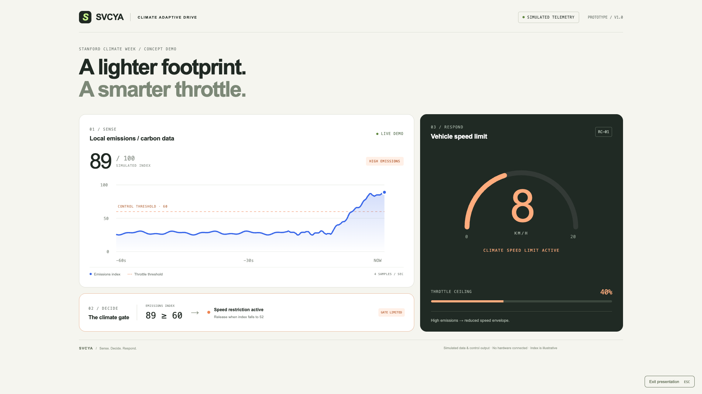

# SVCYA — Climate Adaptive Drive

Standalone pitch-video dashboard built with plain HTML, CSS and JavaScript. No build, dependencies, database, API or hardware connection. All readings and outputs are simulated. The index is illustrative, not CO₂ ppm, AQI or a calibrated emissions measure. No measured climate benefit is claimed.

## Run

Open `dist/index.html` directly in a browser, or run `python3 -m http.server 8765 --directory dist` from this directory and visit http://localhost:8765.

## Record

Use a 1440 × 1100 or 1920 × 1080 browser window. Click **Presentation mode** to hide the controls, then press **R** to restart from a clean baseline. Press **Space** to pause or resume. **Escape** exits presentation mode. Browser fullscreen is optional.

The 48-second sequence repeats: baseline → rising emissions → restricted speed → clearing air → normal speed restored. **Trigger spike** and **Clear air** let you control the scene manually; the selected scene remains active until R or restart. Manual controls resume playback if paused.

## Control rule

- Index ≥ 60: speed limit transitions from 20 to 8 km/h; throttle ceiling becomes 40%.
- The restriction stays active until index ≤ 52, then speed returns to 20 km/h.
- This hysteresis prevents flickering near the threshold.
- The graph retains 60 seconds at four samples per second. Initial history is a synthetic baseline.
- Speed digits ease to the selected limit for readability; they are a visual control output, not actual vehicle velocity.

The demo advances only while the browser is rendering. Keep the tab in the foreground when recording. Internet is not required for the local files.

## Preview

Additional screenshots show [clear conditions](screenshots/svcya-clear.png), [the spike with controls](screenshots/svcya-spike.png), and [the mobile layout](screenshots/svcya-mobile.png).

## Validation

Verified in Chrome: automatic spike and recovery, pause/resume, manual spike/clear controls, restart, presentation mode, mobile layout without horizontal overflow, and no JavaScript runtime errors.
